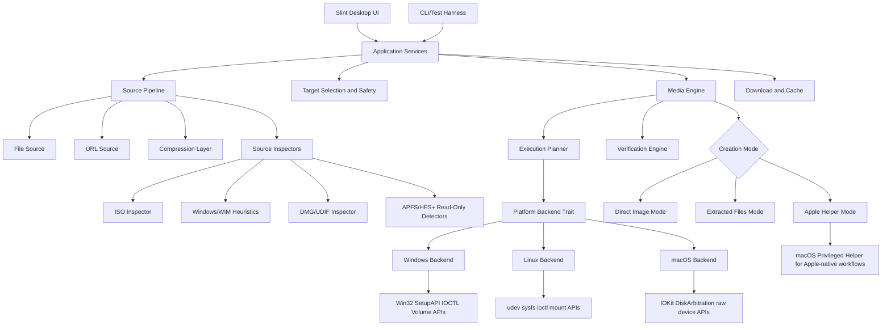

# Project Specification: Cross-Platform USB Bootable Media Tool

## Status

Definitive implementation PRD. This document consolidates `ASSESSMENT.md` and `ETCHER_ANALYSIS.md` into a single product and engineering specification for the first full build of the project.

## 1. Project Vision

Build a modern, safety-first, cross-platform bootable media tool in Rust for Windows, Linux, and macOS that combines Etcher’s approachable workflow and verification defaults with Rufus-style compatibility and advanced media preparation where it is actually needed. The product should be fast, compact, and maintainable, with one shared Rust core, thin privileged OS backends, and a Slint desktop UI. Its defining goal is not to clone either incumbent literally, but to become the most reliable way to create bootable USB media across all three desktop platforms, including Linux installer images, Windows installer media, and macOS DMG-based installer workflows.

## 2. Product Principles

- Cross-platform correctness over platform-specific shortcuts
- Safe-by-default destructive operations
- Simple default workflow, advanced options only when relevant
- Verification is part of the normal flow, not an expert feature
- Shared pure-Rust planning core, OS-specific execution backends
- Clear support matrix instead of vague “works with everything” claims
- macOS installer support is required, but implemented in phases based on what can be made reliable

## 3. Combined Feature Set

### 3.1 MVP (Phase 1)

The MVP is a reliable cross-platform imaging product, not a full Rufus parity release.

#### Core workflow

- Three-step UI: `Select source -> Select target -> Flash`
- Slint desktop UI for Windows, Linux, macOS
- Drag-and-drop source selection
- Local file sources
- URL sources over `http` and `https`
- Progress, ETA, effective write speed, and stage reporting
- “Flash another” completion flow
- Structured logs with export for bug reports

#### Safety and validation

- Hide internal/system drives by default
- Require explicit advanced override to expose dangerous targets
- Strong destructive-write confirmation with target identity details
- Unmount/eject mounted child volumes before write
- Full post-flash verification enabled by default
- Better error categorization: permissions, busy device, corrupt image, device disconnect, insufficient size, verification failure
- Recovery guidance for unreadable or half-written media

#### Source and image support

- Raw disk-image streaming for `img`, `iso`, `dmg`, `raw`, `wic`, `vhd`
- Native compressed-image support for `zip`, `gz`, `bz2`, `xz`
- Unified source abstraction for file and URL inputs
- Image inspection and metadata reporting before flash
- Size validation against decompressed size where determinable

#### Bootable media support

- Linux hybrid ISO direct-write support
- Generic raw-image direct-write support for disk images that already contain the required partition map and boot assets
- macOS DMG direct-write support for block-restorable DMG images that contain a complete bootable disk layout
- GPT and MBR inspection and execution planning
- UEFI-first support

#### Advanced panel, limited in scope

- Verification on/off
- Unsafe target override
- Log verbosity
- Optional checksum display for source image

### 3.2 Phase 2

Phase 2 adds the first “special handling” flows beyond pure direct imaging.

#### Windows media support

- Windows ISO detection and workload-specific UX
- WIM-aware source inspection
- Extracted-files mode for common modern Windows installer scenarios
- FAT32-first strategy with explicit handling for oversized install payloads
- UEFI-focused Windows installer media creation
- Clear blocking for unsupported Windows edge cases instead of silent failure

#### macOS media support expansion

- macOS DMG inspection with partition/filesystem reporting
- APFS/HFS+ aware validation for installer images
- Compatibility classification for DMGs:
  - raw-restorable
  - partition-restorable
  - unsupported wrapper/installer asset
- macOS-hosted helper path for installer creation when Apple tooling is required
- Optional integration with native Apple workflows such as `createinstallmedia` or `asr` through a privileged helper on macOS only

#### UX and distribution improvements

- Recent URL history
- Basic authenticated HTTP source support
- Expanded source-health warnings
- Better target labeling using normalized drive metadata

### 3.3 Phase 3 (Full Parity Track)

Phase 3 is where the product earns “advanced boot media tool” status rather than “excellent cross-platform imager.”

#### Advanced boot and compatibility

- Legacy BIOS support
- GRUB/Syslinux-heavy compatibility paths
- Linux persistence where support is explicit and tested
- More hybrid ISO heuristics
- Expanded boot strategy planner for mixed firmware targets

#### Advanced device workflows

- Multi-target flashing
- Per-target progress and failure isolation
- Source-drive cloning
- Optional sparse/blockmap acceleration for supported formats

#### Advanced filesystems and diagnostics

- NTFS strategy for Windows media where justified
- exFAT expansion if compatibility warrants it
- Bad-block tests
- Fake-flash detection
- Virtual image workflow expansion
- Localization completeness

## 4. macOS DMG-to-USB Deep Dive

### 4.1 What “DMG flashing” means technically

A DMG is typically an Apple UDIF container, not just a raw byte-for-byte disk image file with a different extension. A usable implementation must:

1. Detect whether the source is a UDIF/DMG container
2. Read the DMG trailer and block map
3. Decompress chunked data if the DMG is compressed
4. Determine whether the DMG embeds:
   - a whole-disk image with GPT/MBR already present
   - one or more partitions that must be restored into a planned target layout
   - an installer asset bundle that is not directly restorable
5. Stream the resulting block image to the target device
6. Verify the resulting on-device bytes after write

For Phase 1, the product should only claim support for **block-restorable DMGs**. That means the DMG can be deterministically converted into a raw disk stream whose partition table and boot assets are already correct for the intended target.

### 4.2 What is needed to support macOS installer images

To support macOS installer media reliably, the implementation needs awareness of:

- UDIF/DMG structure and compression methods
- GPT layout and partition identity
- EFI System Partition presence when required
- HFS+ and APFS filesystem detection
- Apple boot file placement and preservation
- Whether the image is intended to be restored as-is or constructed from installer content

The product does **not** need full APFS or HFS+ write support in MVP. It does need enough read/inspection capability to validate that a DMG contains a bootable or restorable layout and to reject unsupported images early.

### 4.3 APFS and HFS+ awareness

macOS installer media historically used HFS+ and, in newer flows, frequently interacts with APFS containers. The tool must understand at least the following:

- **HFS+ / HFSX detection** to identify classic macOS installer volumes
- **APFS container detection** to identify newer installer and restore layouts
- Whether the DMG holds a complete disk image, a single filesystem volume, or a multi-partition arrangement
- Whether the target must preserve partition GUIDs, partition type GUIDs, and boot-critical directory structures

Recommendation:

- Phase 1: inspect and direct-write only
- Phase 2: classify APFS/HFS+ installer layouts more deeply
- Phase 2 on macOS: use Apple-native helper workflows when a file-level installer creation path is required
- Do not attempt pure-Rust APFS/HFS+ authoring in the early product

### 4.4 GPT layout for Mac boot

A bootable macOS USB is not merely “files copied to a FAT partition.” The implementation must assume:

- A GPT disk layout is the default for modern Mac boot media
- An EFI System Partition may be required or already embedded in the image
- The main payload may reside on HFS+ or APFS-backed structures depending on image vintage and installer workflow
- Partition offsets, type GUIDs, and filesystem metadata must be preserved exactly when performing raw restore

Therefore, the correct default strategy for DMG support is:

- prefer **raw restore of a validated disk image**
- avoid “rebuild the target from extracted files” unless the workflow is explicitly supported through Apple tooling

### 4.5 Apple boot chain requirements and caveats

Apple boot media creation is constrained by platform behavior beyond raw disk writing:

- Apple’s official bootable installer workflow uses `createinstallmedia`
- Some installer workflows expect a full macOS installer app, not just a DMG payload
- Modern Macs may require internet access during install for firmware or recovery components
- T2 and Apple Silicon systems may restrict external boot depending on security settings
- A USB that is byte-correct can still fail to boot if the source image itself is not a restorable boot installer

This means the product must distinguish:

- **Supported**: raw-restorable bootable DMGs
- **Conditionally supported**: installer media that can be created on macOS using Apple tooling through a helper
- **Unsupported**: arbitrary DMGs that do not represent a bootable/restorable installer disk layout

### 4.6 Rust crate availability

Current Rust ecosystem findings support a pragmatic read/inspect-first strategy:

- `udif`: promising cross-platform Rust support for DMG/UDIF parsing, partition listing, raw extraction, and modern compression handling
- `apfs`: useful pure-Rust read-only APFS inspection, but limited and not suitable for production authoring
- `hfsplus`: credible read-only HFS+/HFSX inspection support

What is missing:

- production-grade APFS write support
- production-grade HFS+ authoring for bootable installer media
- an end-to-end Rust-native equivalent of Apple’s installer-authoring toolchain

### 4.7 Recommended implementation strategy

#### Phase 1 DMG strategy

- Accept DMG as a first-class source type
- Parse UDIF metadata and compression blocks
- Validate whether the DMG is whole-disk restorable
- Stream-restore the decoded disk image to USB
- Verify readback
- Warn clearly when the DMG is not a supported restorable installer image

#### Phase 2 DMG strategy

- Add filesystem-aware inspection for APFS/HFS+
- Add partition-restorable flows where safe
- On macOS only, add a privileged helper for workflows that require Apple tooling instead of raw restore

#### Explicit non-goal for early phases

- Building bootable macOS installer media purely by synthesizing APFS/HFS+ structures in Rust

### 4.8 Primary risks

- Many DMGs are not directly bootable disk images
- APFS/HFS+ write support in Rust is immature
- Apple boot behavior varies by hardware generation and security policy
- macOS installer distribution formats are not uniform across releases
- A cross-platform UI can expose DMG support consistently, but the underlying success matrix will still depend on source-image type

## 5. Final Architecture

### 5.1 Layered architecture

### 5.2 Architectural interpretation by workload

#### Linux ISO

- Inspect image
- If hybrid/raw-bootable, use **Direct Image Mode**
- Write block stream
- Verify full readback

#### Windows ISO

- Detect Windows installer characteristics
- Route to **Extracted Files Mode** when direct imaging is insufficient
- Plan GPT/FAT32-first layout
- Add Windows-specific media logic in Phase 2

#### macOS DMG

- Parse DMG/UDIF metadata
- If whole-disk restorable, use **Direct Image Mode**
- If installer creation requires Apple-native logic, route to **Apple Helper Mode** on macOS in Phase 2
- Reject unsupported DMGs with explicit explanation instead of best-effort failure

### 5.3 Recommended Rust workspace layout

- `media-core`
  - domain models
  - execution planning
  - safety rules
  - verification and reporting
- `media-source`
  - file/URL source abstraction
  - compression pipeline
  - image inspectors
- `media-platform`
  - backend traits
  - device model normalization
  - privilege and locking abstractions
- `media-platform-windows`
  - Windows storage and volume integration
- `media-platform-linux`
  - Linux removable-media backend
- `media-platform-macos`
  - macOS raw-disk and Disk Arbitration backend
- `media-apple`
  - DMG classification
  - APFS/HFS+ inspection
  - optional macOS helper integration
- `media-ui`
  - Slint app shell
- `media-cli`
  - non-GUI validation, testing, and developer harness

### 5.4 Design rules

- Keep planning pure and testable
- Keep `unsafe` code at backend boundaries only
- Make every flash job an explicit execution plan with stages
- Normalize device metadata across platforms before it reaches the UI
- Keep source acquisition independent from write execution
- Treat unsupported media types as product decisions, not hidden fallbacks

## 6. MVP Scope Definition

### 6.1 What the MVP does

The MVP is a cross-platform Rust desktop application that safely writes bootable USB media from local files or URLs, verifies the result by default, and supports the most reliable bootable-media path first: direct imaging of Linux hybrid ISOs, generic raw disk images, and validated block-restorable macOS DMGs.

### 6.2 What the MVP does not do

- It does not promise full Rufus parity
- It does not create Windows installer USBs from all Windows ISOs yet
- It does not synthesize APFS or HFS+ bootable filesystems from extracted files
- It does not promise legacy BIOS compatibility
- It does not include persistence, multi-target flashing, cloning, bad-block testing, or fake-flash detection
- It does not claim support for arbitrary DMGs; only validated restorable DMGs

### 6.3 MVP acceptance criteria

The MVP is complete only when all of the following are true:

#### Product behavior

- The app runs on supported Windows, Linux, and macOS versions
- The UI exposes a single basic three-step flash flow
- Drag-and-drop source selection works on all three platforms
- File and URL sources share one common flow
- Internal/system drives are hidden by default
- Destructive override requires an explicit advanced action
- Progress UI shows stage, percent, ETA, and throughput
- Logs can be exported from the UI

#### Flashing behavior

- The tool can write at least:
  - 3 representative Linux hybrid ISOs
  - 2 generic raw disk images
  - 1 validated bootable/restorable macOS DMG
- The tool supports `zip`, `gz`, `bz2`, and `xz` compressed sources
- The tool performs full verification by default for successful writes
- A failed verification produces a user-visible failure state and recovery guidance

#### Platform behavior

- Windows backend can enumerate removable devices, lock/unmount them, write raw sectors, flush, and re-scan
- Linux backend can enumerate removable block devices, unmount them, write raw sectors, flush, and re-scan
- macOS backend can enumerate removable devices, coordinate unmount through Disk Arbitration, write raw sectors, flush, and re-scan

#### DMG behavior

- DMG sources are detected and classified before flashing
- Unsupported DMGs are blocked before destructive write begins
- Supported DMGs are restored through a deterministic streaming path and verified afterward

### 6.4 Explicit MVP support statement

The MVP support statement should read:

> Supports cross-platform flashing of Linux hybrid ISOs, generic raw disk images, and validated block-restorable macOS DMGs, with verification enabled by default. Windows installer creation, advanced boot modes, and synthetic macOS installer authoring arrive in later phases.

## 7. Implementation Roadmap

### Milestone 0: Project foundation

- Create Cargo workspace and crate boundaries
- Stand up Slint shell with fake data
- Define source, target, plan, and progress domain models
- Add structured logging and error taxonomy

### Milestone 1: Platform backend bring-up

- Windows removable-device enumeration and exclusive access
- Linux removable-device enumeration and unmount/write flow
- macOS removable-device enumeration, Disk Arbitration coordination, and raw write flow
- Common device metadata normalization and safety classifier

### Milestone 2: Source pipeline and verification

- File and URL source support
- Streaming decompression for `zip`, `gz`, `bz2`, `xz`
- Preflight size checks
- Full verification engine and progress reporting

### Milestone 3: MVP imaging paths

- Linux hybrid ISO direct-write support
- Generic raw-image support
- DMG/UDIF parsing for restorable DMGs
- DMG classification and direct restore flow
- End-to-end UI integration

### Milestone 4: MVP release hardening

- Cross-platform packaging
- macOS signing/notarization plan
- Error-message polish
- Support matrix documentation
- Hardware regression testing on representative USB media

### Milestone 5: Phase 2 Windows media

- Windows ISO detection
- WIM-aware inspection
- Extracted-files path
- FAT32-first UEFI installer generation
- Oversized-file handling strategy

### Milestone 6: Phase 2 macOS expansion

- APFS/HFS+ inspection deepening
- Partition-restorable DMG flows where reliable
- macOS helper mode for Apple-native installer creation
- Clear capability matrix by macOS version and source type

### Milestone 7: Full parity expansion

- Legacy BIOS and broader bootloader strategies
- Persistence and advanced Linux flows
- Multi-target flashing
- Cloning, diagnostics, NTFS strategy, localization

## 8. Open Questions

- **Project name:** what is the shipping name, and do we need to avoid Rufus-adjacent branding entirely?
- **Windows scope timing:** should common Windows 11 installer creation be Phase 2’s only Windows target, or do we support older installers immediately?
- **macOS support statement:** do we want MVP marketing to say “macOS DMG support” only, or “macOS installer support” with a qualified matrix?
- **macOS helper policy:** are we comfortable using Apple-native tools on macOS for installer-authoring flows that cannot be reproduced safely in pure Rust yet?
- **Support matrix floor:** which minimum OS versions do we support for Windows, Linux distributions, and macOS?
- **Verification policy:** do we require full readback verification for every write, or allow sampled verification only for extremely large media in later phases?
- **Privilege model:** do we ship one privileged helper per platform or keep privilege elevation inside the main app process initially?
- **Licensing and assets:** what bundled boot assets, if any, are acceptable for later BIOS/Windows parity work?
- **Telemetry and crash reporting:** do we want any opt-in diagnostics pipeline, or keep the product entirely offline-first?
- **CLI scope:** is the CLI internal-only, or a supported public interface for automation and CI use?

## 9. Final Product Decision

This project should be executed as a **cross-platform Rust boot-media platform with a safe shared core and explicit backend boundaries**, not as a direct clone of Rufus or Etcher. The correct first release is a highly reliable direct-imaging product with DMG support limited to validated restorable images, followed by deliberate expansion into Windows installer workflows and Apple-native helper flows where raw restore is insufficient. That path is implementable, aligned with current Rust ecosystem strengths, and consistent with the goal of shipping a real product rather than chasing premature full parity.